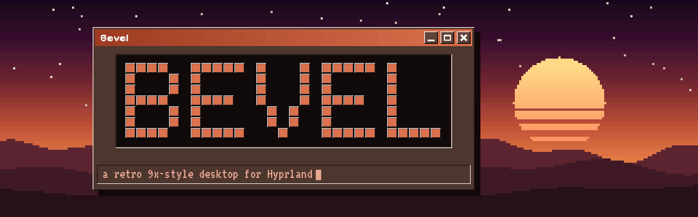
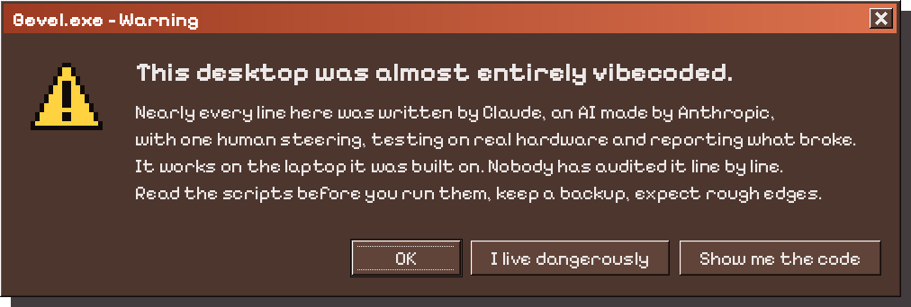
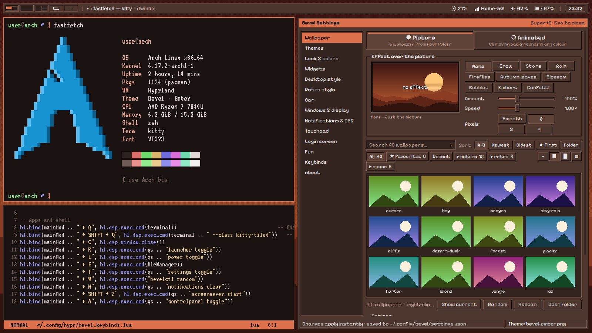
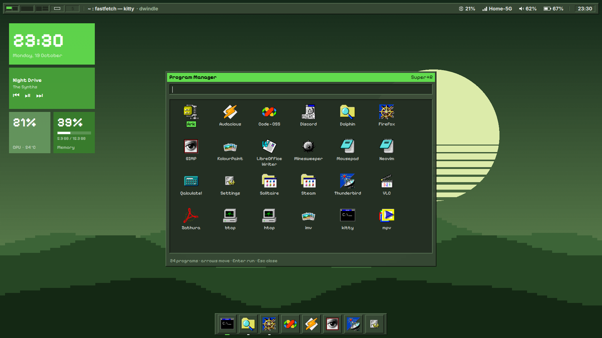
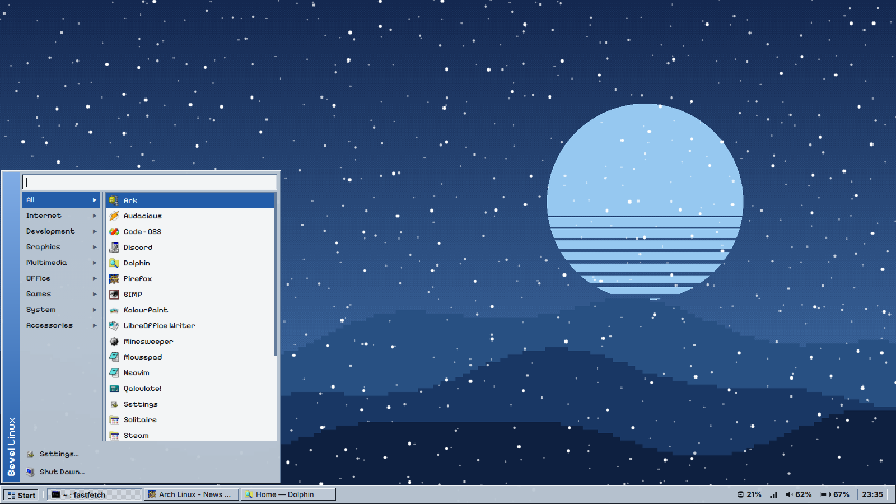
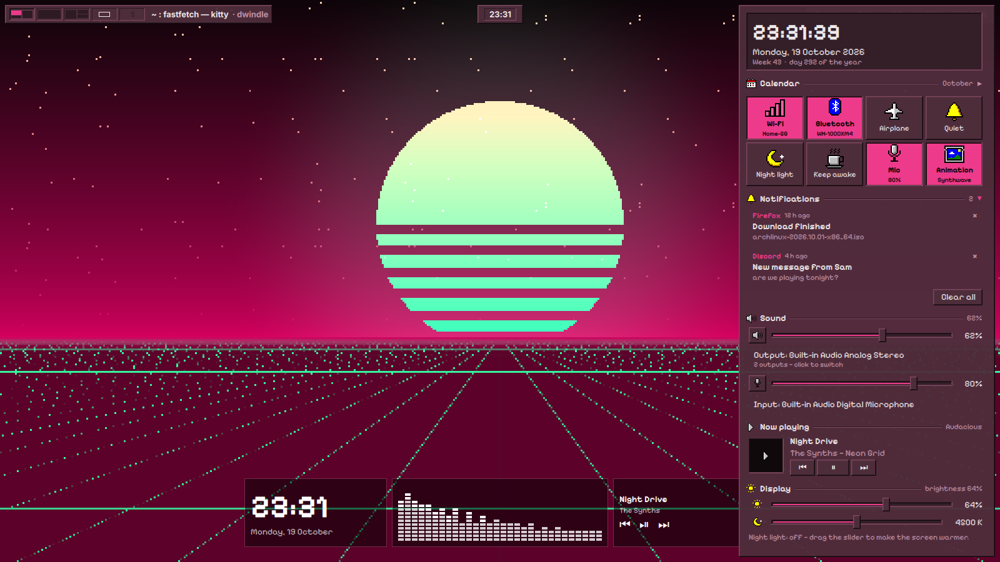
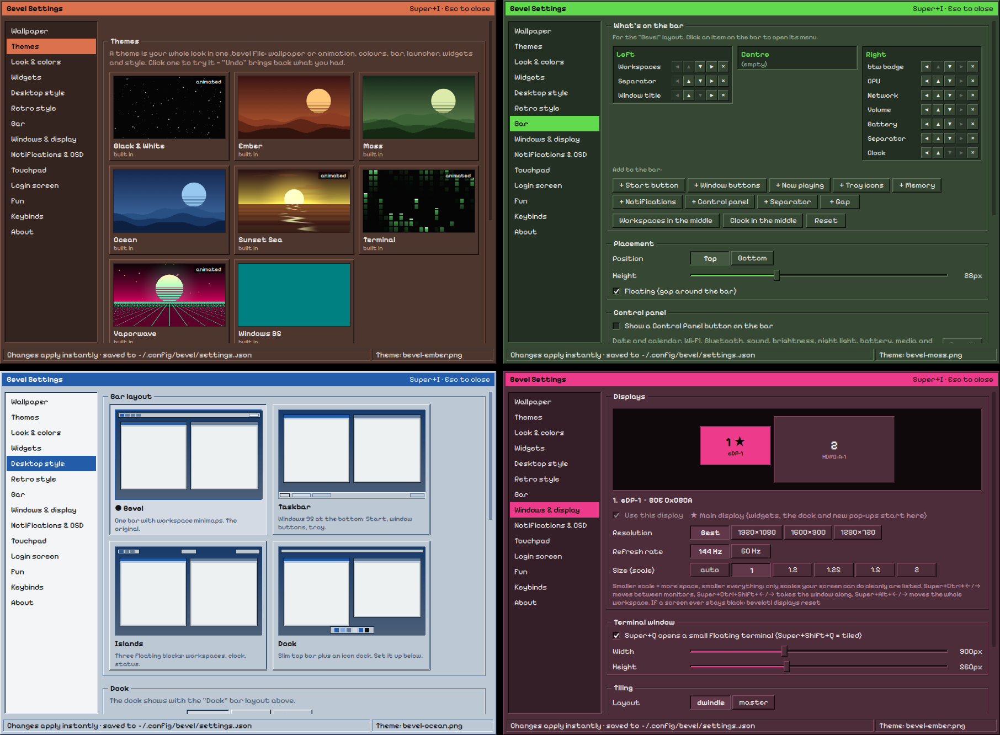

<div align="center">



### A retro, 9x-flavoured desktop for Hyprland, recoloured from your wallpaper.


[**Screenshots**](#-screenshots) · [**Features**](#-whats-inside) · [**Install**](#-install) · [**Keys**](#-keys) · [**Manual**](docs/MANUAL.md) · [**Credits**](#-credits)

</div>

<br>

<p align="center"></p>

> [!WARNING]
> **Bevel is almost entirely vibecoded.** Nearly all of it was written by **Claude**, Anthropic's AI: the Quickshell shell, the `bevelctl` theme engine, the installer, the login screen, the pixel icons and pointers, the animated backgrounds, even this README. **[@MordoMordeczek](https://github.com/MordoMordeczek)** came up with it, steered it, and tested every build on a real laptop.
>
> So:
> - It works on the machine it was made on (Arch, Hyprland 0.55 with the Lua config). Other GPUs, distros and setups are untested.
> - No human has reviewed the code line by line. **Read `install.sh` before you run it.** It uses `sudo` for packages, the login screen and the pointer theme.
> - Your old config is backed up to `~/.config/bevel-backup-<date>/`, and `./uninstall.sh` puts it back. Keep your own backup anyway.

<br>

## 📸 Screenshots

<p align="center"></p>

<table>
  <tr>
    <td width="50%"></td>
    <td width="50%"></td>
  </tr>
  <tr>
    <td align="center"><sub><b>Moss</b> · dock layout, Program Manager, desktop tiles</sub></td>
    <td align="center"><sub><b>Ocean</b> · light panels, the 95 taskbar and Start menu, snow on top</sub></td>
  </tr>
  <tr>
    <td width="50%"></td>
    <td width="50%"></td>
  </tr>
  <tr>
    <td align="center"><sub><b>Vaporwave</b> · animated background, islands, control panel</sub></td>
    <td align="center"><sub><b>Bevel Settings</b> · one app for everything, in four palettes</sub></td>
  </tr>
</table>

<sub>The pictures are rendered from Bevel's own QML in a headless test harness with made-up data. The bar, panels, menus, widgets and Settings are the real shell; the terminal and editor in the first shot are drawn in.</sub>

<br>

## ✨ What's inside

<table>
<tr><td width="50%" valign="top">

**🎨 Your wallpaper picks the colours**<br>
Pick a picture and the bar, menus, kitty, Hyprland borders, GTK, Qt/Dolphin, Firefox, VS Code, Neovim, btop, the login and lock screens and the mouse pointer all follow it. A black-and-white wallpaper turns the whole desktop greyscale.

**🖼️ 28 animated backgrounds**<br>
Synthwave, Pixel hills, Starfield, Hyperspace, Aurora, Code rain and more, as GPU shaders in any colour and palette, with chunky-pixel and 90s-dither options. Or keep a picture and put snow, fireflies, embers or confetti over it.

**🧱 Four desktop layouts**<br>
*Bevel* (one bar with live workspace minimaps), *Taskbar* (Windows 95, with Start), *Islands*, and *Dock*. You choose what goes on the bar and where.

**🚀 Launcher in three looks**<br>
Run box, Program Manager or Start menu. It also does maths: type `=12*7`.

</td><td width="50%" valign="top">

**🎛️ Control panel and bar menus**<br>
Wi-Fi, Bluetooth, sound, brightness, night light, battery and power modes, now playing, notifications. The clock menu has a calendar, world clocks, a stopwatch and a timer.

**🧩 Desktop widgets**<br>
Metro-style tiles: clock, calendar, system info, CPU/RAM, weather, sticky notes, music visualizer, RSS, Pomodoro, and a Minesweeper you can play.

**⚙️ Bevel Settings (Super+I)**<br>
Wallpaper browser for big folders, themes as shareable `.bevel` files, displays, dock, pointer, touchpad, keybinds, all in one 9x app.

**🕹️ The fun stuff**<br>
Screensavers, Tip of the Day, a start-up chime, an "I use Arch btw" badge, and Bevvy the desktop sheep.

</td></tr>
</table>

Also included: a Windows 95-style **setup wizard**, an **SDDM login screen** and **hyprlock** in your colours, retro **Chicago95** icons, Alt+Tab, clipboard history, notifications, an on-screen display and multi-monitor support. The full tour is in the **[manual](docs/MANUAL.md)**.

<br>

## 💾 Install

> [!IMPORTANT]
> For **Arch Linux** with **Hyprland 0.55+ using the Lua config** and **Quickshell 0.3**. The installer gets everything else through pacman.

```sh
git clone https://github.com/MordoMordeczek/bevel.git
cd bevel
./install.sh
```

The installer is a Windows 95-style wizard. Pick the login screen, retro icons, a starting wallpaper and the apps you want, then press **Install**. pacman asks for your password once and the rest runs by itself. The first time you log in, a short **Welcome tour** opens. Super+F1 lists every shortcut at any time.

| Option | What it does |
|---|---|
| `./install.sh --no-pkgs` | Update the config only, without reinstalling the rice's packages |
| `./install.sh --apps` | Just the apps page, to add apps later |
| `./install.sh --yes` | No wizard: everything, plus the recommended apps |
| `./uninstall.sh` | Put your old config back |

Run it from a terminal **inside Hyprland** if you can, so it can pick a display scale that fits your screen. To update, `git pull`, then run `./install.sh --no-pkgs`.

<br>

## 🔑 Keys

| Keys | | Keys | |
|---|---|---|---|
| <kbd>Super</kbd>+<kbd>Q</kbd> | Terminal (floating) | <kbd>Super</kbd>+<kbd>I</kbd> | Bevel Settings |
| <kbd>Super</kbd>+<kbd>Shift</kbd>+<kbd>Q</kbd> | Terminal (tiled) | <kbd>Super</kbd>+<kbd>A</kbd> | Control panel |
| <kbd>Super</kbd>+<kbd>R</kbd> | Launcher | <kbd>Super</kbd>+<kbd>V</kbd> | Clipboard history |
| <kbd>Super</kbd>+<kbd>E</kbd> | Files (Dolphin) | <kbd>Alt</kbd>+<kbd>Tab</kbd> | Switch windows |
| <kbd>Super</kbd>+<kbd>C</kbd> | Close window | <kbd>Super</kbd>+<kbd>W</kbd> | Random wallpaper |
| <kbd>Super</kbd>+<kbd>F</kbd> | Fullscreen | <kbd>Super</kbd>+<kbd>L</kbd> | Shut down menu |
| <kbd>Super</kbd>+<kbd>1</kbd>…<kbd>0</kbd> | Workspaces | <kbd>Super</kbd>+<kbd>Esc</kbd> | Lock |
| <kbd>Super</kbd>+<kbd>Ctrl</kbd>+<kbd>←</kbd>/<kbd>→</kbd> | Other monitor | <kbd>Print</kbd> | Screenshot a region |

Everything else is in the [manual](docs/MANUAL.md#keys), or press <kbd>Super</kbd>+<kbd>F1</kbd>.

<br>

## 🛠️ `bevelctl`

The theme engine behind it all. The shell and Settings use it, and you can call it from a terminal:

```sh
bevelctl wallpaper ~/Pictures/Wallpapers/foo.png   # set a wallpaper and recolour everything
bevelctl live synthwave '#c03070' neon             # animated background (live off = back to a picture)
bevelctl theme import Vaporwave.bevel              # someone's whole look, in one file
bevelctl set style.rounding 0 windows.gapsIn 6     # change any setting
bevelctl doctor                                    # write a report to ~/bevel-report.txt
```

<br>

## 🐛 Something broke?

Super+I → About → **Make a bug report** writes `~/bevel-report.txt`. Look through it before you share it: it can contain your user name, host name and paths. Then [open an issue](../../issues/new/choose). The [troubleshooting section](docs/MANUAL.md#troubleshooting) covers the usual suspects (a black animated background, no bar, Hyprland config errors).

<br>

## 💛 Credits

| | |
|---|---|
| **[@MordoMordeczek](https://github.com/MordoMordeczek)** | The idea, the taste, every "this is laggy" and "the cursor still doesn't change", and all the testing on real hardware. |
| **Claude** (Anthropic) | Co-author. Wrote nearly all of the code, the pixel art and the docs, through a lot of conversations. |
| **[Chicago95](https://github.com/grassmunk/Chicago95)** by grassmunk and contributors | The Windows 95 GTK theme in `gtk/chicago95` and the optional retro icons. GPL-3.0 / MIT; see `gtk/chicago95/CREDITS`. |
| **[Hyprland](https://hyprland.org)** · **[Quickshell](https://quickshell.org)** | What Bevel runs on. |
| **Pixelify Sans** · **VT323** | The pixel UI font and the terminal font (SIL Open Font License), downloaded by the installer. |

<br>

## 📜 License

Bevel's own code is under the [MIT License](LICENSE). The bundled Chicago95 parts keep their own licence: see [`gtk/chicago95`](gtk/chicago95).

<div align="center">
<br>
<sub>Made with too many late nights and one very patient AI · <i>It's now safe to turn off your computer.</i></sub>
</div>
