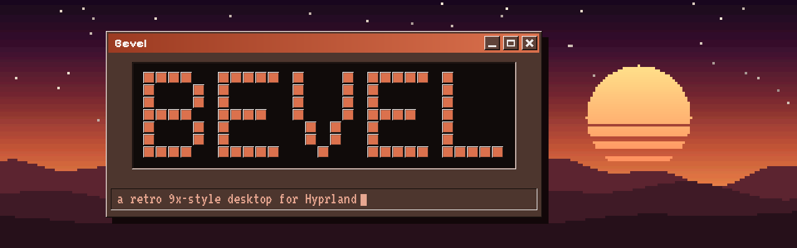

<div align="center">



# The Bevel manual

Everything Bevel does, page by page. Back to the [README](../README.md).

</div>

> [!NOTE]
> Like the rest of Bevel, this manual was written almost entirely by Claude, and it describes the build it was tested on. If something here doesn't match what you see, [open an issue](https://github.com/MordoMordeczek/bevel/issues).

## Contents

- [Install](#install)
- [Apps](#apps)
- [Keys](#keys)
- [Wallpapers](#wallpapers)
- [Animated backgrounds](#animated-backgrounds)
- [Effects over a picture](#effects-over-a-picture)
- [Control panel](#control-panel)
- [The bar](#the-bar)
- [Dock](#dock)
- [Mouse pointer](#mouse-pointer)
- [Themes](#themes)
- [Clipboard, Alt+Tab and notifications (Hyprland)](#clipboard-alttab-and-notifications-hyprland)
- [Desktop widgets](#desktop-widgets)
- [Icons](#icons)
- [Bevel Settings](#bevel-settings)
- [Hyprland desktop styles](#hyprland-desktop-styles)
- [Fun](#fun)
- [Your distro](#your-distro)
- [Where things live](#where-things-live)
- [Firefox](#firefox)
- [Login screen](#login-screen)
- [Keyboard & touchpad](#keyboard--touchpad)
- [Several monitors](#several-monitors)
- [bevelctl](#bevelctl)
- [Troubleshooting](#troubleshooting)

## Install

```sh
git clone https://github.com/MordoMordeczek/bevel.git
cd bevel
./install.sh
```

The installer is a Windows 95-style setup wizard. Pick the login screen, retro icons, the starting wallpaper and the apps, then press Install. pacman asks for your password once and the rest runs by itself. A short **Welcome tour** opens the first time you log in (Super+F1 shows every shortcut any time).

> **Heads-up:** Bevel is a hobby project made and tested on one Arch Linux laptop (Arch-based distros should work too, see [Your distro](#your-distro)). On other hardware some things might break or look wrong, especially with other GPUs, several monitors or an older Hyprland (it needs 0.55+ with the Lua config). Your config is backed up first and `./uninstall.sh` puts it back. If something breaks, Super+I → About → **Make a bug report** collects what's needed.

Your old files are copied to `~/.config/bevel-backup-<date>/` first, and `./uninstall.sh` puts them back.

| Option | What it does |
|---|---|
| `./install.sh --apps` | Only the apps page, to add apps later |
| `./install.sh --no-pkgs` | Update the config without reinstalling the rice's packages (apps you tick are still installed) |
| `./install.sh --yes` | No wizard: everything plus the recommended apps |
| `./install.sh --update` | Install a newer version over this one: no wizard, no packages, your earlier choices kept |
| `./install.sh --no-upgrade` | Don't run a system update (`pacman -Syu`) before installing packages |

Before it installs anything, Setup switches on network time (package signatures need a correct clock), refreshes the package keys and updates the whole system with `pacman -Syu`, the way Arch expects; `--no-upgrade` skips that. Setup takes your keyboard layout from the system (`localectl`) and lets Hyprland pick a display scale that fits your screen. Change either one in Super+I.

**Updating:** `bevelctl update`, or Super+I → About → **Check for updates** → **Update now**. It runs `git pull` in the folder you installed from, then `./install.sh --update`. Your settings, wallpapers, `user.lua` and kitty's `user.conf` stay as they are. If you changed Bevel's own files in that folder, it stops and tells you; put your changes in `user.lua` instead. Installed from a download rather than git? Clone it once (`git clone https://github.com/MordoMordeczek/bevel.git ~/bevel`), run `./install.sh --update` from there, and `bevelctl update` works from then on.

## Apps

These come preconfigured, and their colours follow your wallpaper like the rest of the rice. Bevel only writes config files it created itself, so your own configs are left alone.

| App | What Bevel sets up |
|---|---|
| Visual Studio Code (Code - OSS) | A "Bevel" colour theme: accent title bar, grey 9x panels, editor in your terminal colours. Also a block cursor and no ligatures |
| Neovim | A `bevel` colour scheme, plus a starter `init.lua` if you have none |
| Audacious | The Winamp-style interface with a skin recoloured in your palette |
| cmus | A `bevel` colour scheme |
| mpv | A boxy control panel in your colours, pixel font, screenshots to `~/Pictures/Screenshots` |
| Celluloid | Uses the 9x window theme |
| cava | Visualizer bars in an accent gradient |
| imv, Zathura | Themed image and PDF viewers |
| btop | Square boxes, block graphs, your colours |
| Ark, Qalculate!, Mousepad, KolourPaint, Solitaire, Minesweeper | Use the Bevel window and colour theme |

The video, music, image and PDF apps you pick become the default apps for those file types. To theme apps you installed some other way, run `bevelctl apps-setup`.

## Keys

| Keys | Action |
|---|---|
| Super+Q | Terminal, small floating window |
| Super+Shift+Q | Terminal, tiled |
| Super+C | Close window |
| Super+R | Run / app menu |
| Super+L | Lock · log out · suspend · restart · shut down |
| Super+E | Dolphin |
| Super+I | Bevel Settings (its own app) |
| Super+W | Random wallpaper (or a random animation when the animated background is on) |
| Super+Shift+W | Random favourite wallpaper |
| Super+A | Control panel |
| Super+V | Clipboard history |
| Alt+Tab | Switch windows (hold Alt, tap Tab) |
| Super+F1 | Every keyboard shortcut |
| Super+Esc | Lock the screen |
| Super+N | Clear notifications |
| Super+F / Super+Shift+F | Fullscreen / maximize (toggle) |
| Super+Shift+V / J / P | Float · flip split · pseudo-tile |
| Super+arrows | Move focus |
| Super+1…0, Super+Shift+1…0 | Switch workspace / send window there |
| Super+S, Super+Alt+S | Show/hide scratchpad, send window to scratchpad |
| Print or Super+Shift+S, Shift+Print, Super+Print | Screenshot of a region / the screen / the active window |
| Volume, brightness, media keys | Work, with an on-screen pop-up |
| Super+Shift+Z | Screensaver |

Screenshots are saved to `~/Pictures/Screenshots` and copied to the clipboard.

## Wallpapers

Super+I → **Wallpaper** is built for big collections:
- **Search** by name or folder as you type.
- **Sort** A–Z, newest, oldest, favourites first, or by folder.
- **Filters:** All, ★ Favourites, Recent, and one for each folder inside your wallpaper folder.
- **Four sizes:** small, medium and large thumbnails, or a list with resolution and date.
- **Favourites:** click the ☆ on a picture, or right-click it. **Random ★** and Super+Shift+W pick only from them, and Super+W can too.
- **Show current** jumps to the wallpaper you're using.

Thumbnails are made once and cached, so even thousands of pictures open quickly. New ones show their name until the thumbnail is ready.

## Animated backgrounds

On the same page, switch from **Picture** to **Animated**. Then pick a colour, a palette (Night, Dusk, Neon, Pastel, Day or Black & white) and one of 28 animations: Synthwave, Pixel hills, Sunset sea, Starfield, Hyperspace, Galaxy, Aurora, Clouds, Snowfall, Rain, Fireflies, Fire, Waves, Lava lamp, Bubbles, Plasma, Kaleidoscope, Vortex, Tunnel, Sunburst, Checkerboard, Maze tiles, Desktop patterns, Halftone, Code rain, Equalizer, Radar and Bouncing logo. Hover over a card to preview it.

- The whole desktop takes its colours from the colour you pick, the same way it would from a wallpaper.
- **Speed**, **pixel size** (smooth up to big chunky pixels), **frame rate** and a **90s dither** are on the same page. Bigger pixels are also lighter on the GPU.
- It pauses during the screensaver, and on battery too if you tick that.
- The login screen, lock screen and Firefox's new tab use a still frame of the animation.

From a terminal: `bevelctl live hyperspace '#c03070' neon`, `bevelctl live list`, `bevelctl live off`.

## Effects over a picture

Keep a normal wallpaper and put something moving on top: Settings → Wallpaper → Picture → **Effect over the picture**. Snow, Stars, Rain, Fireflies, Autumn leaves, Blossom, Bubbles, Embers or Confetti, in white, your accent or another colour, with amount, speed and pixel size.

## Control panel

Super+A slides it in along the right edge of the screen, the full height. It keeps the same gaps as your bar: with a floating bar it floats too, and with a bar flush against the edge it sits flush as well. You can also put a button on the bar in Super+I → Bar → Control panel. It has:
- the time, the full date, the week number and a calendar
- quick switches for Wi-Fi, Bluetooth, airplane mode, quiet mode (no notification pop-ups), night light, keep awake (no auto-lock or sleep), the microphone, and animated vs. picture wallpaper
- **Sound:** output and microphone volume, mute, and which device to use
- **Display:** brightness and how warm the night light is
- **Battery:** charge, time left or time to full, power draw, health, and power modes (Performance / Balanced / Saver)
- **Wi-Fi:** networks with signal, connect (it asks for the password), disconnect
- **Bluetooth:** paired devices with their battery, connect or disconnect
- **Now playing:** the current song, with play/pause, next and previous
- **System:** CPU, memory, disk, temperature, uptime
- shortcuts to Settings, Screenshot, Lock and Power

Click anywhere outside it or press Esc to close it. It uses `hyprsunset` (night light), `bluez-utils` (Bluetooth) and `power-profiles-daemon` (power modes); the installer adds them. If you use TLP, power modes are hidden.

## The bar

Click the clock, battery, volume, network, CPU or notifications on the bar and a small menu drops down under it (click it again to close it, or click the next one to switch). The clock one has the time, a calendar, world clocks, a **stopwatch** (pause, laps) and a **timer** (quick 30 s / 1 / 5 / 10 / 25 min, or any length down to the second with the minute and second spin boxes — type, scroll or click the arrows; pause, +30 s, +1 min, a progress bar, a ring at the end). While either runs it shows on the bar next to the clock; untick "Show on the bar while running" if you'd rather not. The other menus have the matching control panel parts. The clock, calendar, world clock, battery, network, CPU/RAM/disk and media **desktop widgets** open the same menus. `bevelctl flyout clock|battery|sound|network|system|notifs` opens one from a keybind.

Settings → Bar → **What's on the bar** decides what goes where: three columns (left, centre, right), arrows to move things, × to take one off, buttons to put them back, plus separators and gaps. "Workspaces in the middle" and "Clock in the middle" are one click. Each bar layout (Bevel, Taskbar, Islands) keeps its own arrangement.

## Dock

The "Dock" bar layout adds an icon dock. Settings → Desktop style → Dock: bottom, left or right; icon size; a 9x panel, glass, flat, accent or no background; icons on buttons or plain; grow on hover; running apps; auto-hide (touch the screen edge to bring it back). **Pinned apps** are cards you can reorder or remove, and **Add apps** lists everything installed with a search box. Right-click an icon in the dock for: new window, pin/unpin, move, close. Middle-click opens a new window; clicking a running app again cycles its windows.

## Mouse pointer

Bevel draws its own Windows 9x pointers (arrow, hand, I-beam, the trickling hourglass, resize arrows…) in **white**, **black**, your **accent** colour (it follows the wallpaper) or **any colour**, in three sizes: Settings → Look & colors → Mouse pointer. "System default" gives your old pointer back. Apps that are already open switch when they restart. The login screen gets a copy when you install the SDDM theme.

## Themes

Super+I → **Themes**. A theme is your whole look in one `.bevel` file: the wallpaper picture (or animation), colours, bar layout, launcher, widgets and style.
- **Built in:** Windows 95, Vaporwave, Terminal, Ocean, Ember, Moss, Black & White and Sunset Sea. Click one to try it, and **Undo last theme** brings back what you had.
- **Export:** "Save my look as a theme" writes `~/Bevel Themes/<name>.bevel`, with the wallpaper inside it if you like, ready to share.
- **Import:** double-click a `.bevel` file in your file manager, or paste its path in Settings. From a terminal: `bevelctl theme import file.bevel`.
- A theme only changes how things look. It never touches your folders, favourites, touchpad or lock settings.

## Clipboard, Alt+Tab and notifications (Hyprland)

- **Super+V:** what you copied before (text and images), with search. Enter copies it again, Del removes it. Uses `cliphist`.
- **Alt+Tab:** a Windows 95-style box with the open windows' icons in a row, most recent first. Hold Alt, tap Tab, let go.
- **Notifications:** every notification is kept in the control panel's Notifications list, so with Quiet on you can see what you missed. The bar button shows a red count.

## Desktop widgets

Super+I → **Widgets** puts tiles on your desktop that line up by themselves, like the Windows 8 start screen:

| Widget | Sizes | |
|---|---|---|
| Clock | 1×1, 2×1, 2×2 (analog) | click: control panel |
| Calendar | 2×2, 3×2 | |
| System info | 2×1 – 4×2 | fastfetch on your desktop: the Arch logo, user@host, then as many lines as fit (OS, kernel, uptime, packages, WM, CPU, memory, GPU…) |
| I use … btw | 1×1, 2×1 | |
| ASCII text | 2×1 – 4×2 | your own text in big block letters (blocks, shaded, dots or # signs) |
| CPU, Memory, Disk, Battery, Uptime | 1×1, 2×1 | CPU has a history graph |
| Network | 2×1 | connection and live download/upload speed |
| Now playing | 2×1, 2×2 | with cover art at 2×2 |
| Weather | 1×1, 2×1 | from wttr.in; set a city or leave it empty |
| Sticky note | 2×1 – 3×2 | type straight into it; saved to `~/.config/bevel/notes.txt` |
| Did you know? | 2×1, 3×1 | |
| App tiles | 2×1 – 4×2 | your pinned apps as big tiles |
| World clock | 2×1, 2×2, 3×1 | other cities (set them as `Name\|Time/Zone`) |
| News ticker | 4×1, 3×1, 2×2, 3×2 | headlines from any RSS/Atom feed, Arch news by default |
| Visualizer | 2×1 – 4×1, 2×2 | bars that dance to your music (uses `cava`) |
| Pomodoro timer | 1×1, 2×1 | 25 min focus / 5 min break, with a notification |
| Minesweeper | 2×2, 3×3, 4×3 | the real game: left-click opens, right-click flags, the face restarts |
| Recycle Bin, My Computer, Home, My Documents, Downloads, Terminal | 1×1 | desktop icons as tiles; right-click the Recycle Bin to empty it |

Pick the order and size of each, and where they go: any corner, along the top or bottom edge, down the left or right side, or in the middle (a 3×3 position picker). Arrange them as a grid with a set number of columns, one row, or one column. You can also set the tile size and gaps, and the look: **Metro tiles** (flat squares in shades of your accent), **9x windows**, **9x panels** or **Glass**. They sit on the desktop under your windows and work over a picture or an animated background.

## Icons

Super+I → Look & colors → Icon style switches between **Retro** (the Windows 95 Chicago95 set, used by the Run menu, dock, taskbar and your apps) and **Modern** (Breeze). The control panel, widgets and login screen use Bevel's own 16×16 pixel icons in the 9x style. The installer downloads Chicago95 when "Retro icons" is ticked.

## Bevel Settings

Super+I opens Bevel Settings as its own small app. Its **About** page shows the version, checks for updates, and has buttons that open your config files in VS Code (or VSCodium, Zed, Kate, Neovim…; "Open with" picks): `settings.json`, your Hyprland tweaks in `user.lua`, the keybinds, the Hyprland folder, the shell's QML, kitty's `user.conf`, or the Bevel folder in your file manager. Bevel's own files (keybinds, the shell) are replaced when you update, so keep your changes in `user.lua` and `user.conf`. `bevelctl edit user|settings|keybinds|hypr|shell|kitty|folder` does the same from a terminal.

 Every change is saved through `bevelctl patch`, which merges just the changed setting into `settings.json` under a lock. The bar, the settings window and `bevelctl` can't overwrite each other's changes any more, so switching wallpapers, animations and colours quickly is safe.

## Hyprland desktop styles

These live in Super+I → Desktop style, and each one has a live preview in your colours.

**Bar layout**
- **Bevel:** one bar with workspace minimaps.
- **Taskbar:** a Windows 95 taskbar along the bottom, with Start, window buttons, tray icons and the clock.
- **Islands:** three floating blocks for workspaces, the clock and status.
- **Dock:** a slim top bar plus an icon dock. Right-click an icon to pin or unpin it.

**Launcher (Super+R)**
- **Run box:** a scrolling list.
- **Program Manager:** a window of icons.
- **Start menu:** categories, with a side banner.

In every style the list scrolls with the wheel, arrow keys and PgUp/PgDn. Typing `=12*7` calculates and Enter copies the answer. Anything that isn't an app runs as a command.

While the wallpaper or colours change, a "Repainting your desktop" box covers the screen until everything has reloaded. You can turn it off on the same page.

**Shut-down menu (Super+L):** a classic dialog, five big tiles, or a small drop-down from the bar's corner. Shutting down or restarting can show "It's now safe to turn off your computer" first; press Esc there to cancel.

**Dolphin and Firefox** only read their colours when they start, and both keep running in the background. Bevel restarts Dolphin after a colour change, and its tabs come back. Firefox does the same if you turn it on in Look & colors, or once with `bevelctl restart-apps firefox`.

## Fun

These are in Super+I → Fun:
- an "I use *your distro* btw" badge for the bar (click it) and a line in fastfetch
- screensavers (Starfield, Mystify, Pipes) after a set idle time, or with Super+Shift+Z
- a Windows-style Tip of the Day at login
- an original start-up chime (`bevelctl chime`)
- Bevvy, a pixel desktop sheep. Click it.
- in Super+R: `fortune`, `fetch`, `sheep`, `party`, `btw` … and an old cheat code
- something happens if you click the logo on the About page. Close the window it opens to make it stop.

**Black & white wallpapers:** when the wallpaper has (almost) no colour, the whole desktop goes greyscale too: panels, accents, terminal and apps. Look & colors → "Black & white" can also force it on or off.

## Your distro

Bevel runs on **Arch Linux and the distros built on it**: CachyOS, EndeavourOS, Manjaro, Garuda, Artix and friends. Setup needs pacman, so Fedora, Debian and others can't run it (yet).

- **Names and logos follow your distro.** fastfetch, the System info and "btw" widgets, the bar badge, the Start menu banner and the login screen read `/etc/os-release`, so on CachyOS it's "I use CachyOS btw" and the login screen says CachyOS Linux.
- **The logo:** on Arch it's Bevel's hand-drawn pixel Arch. On other distros Bevel takes the logo picture your distro installs (the `LOGO` from `/etc/os-release`, found in `/usr/share/pixmaps` or the hicolor icons) and turns it into 32×32 pixel art in a few flat colours with a 9x bevel, for both the widgets and fastfetch. If there's no picture, the widgets show a little 9x computer and fastfetch uses its own logo.
- **Change it:** Super+I → Fun → **Your distro**. Type a different name, or pick the logo: *Auto*, *Bevel's pixel Arch* (for everyone who misses it), *Classic fastfetch* (fastfetch's built-in text logo) or *None*. `bevelctl distro --json` shows what Bevel detected.
- **Packages your repos don't have:** Setup installs what it can with pacman. If something Bevel can't run without (Quickshell, Hyprland and its tools) is missing from your distro's repos, Setup builds it from the AUR with `paru` or `yay` when you have one; otherwise it tells you what to install. Manjaro's stable branch can be behind Arch, so check that your Hyprland is 0.55 or newer.
- **No systemd (Artix):** Setup adds the `-openrc`, `-runit`, `-dinit` or `-s6` service packages, switches Bluetooth and power modes on for your init system, and shows the command to make SDDM your login manager instead of changing it for you. The shut-down menu uses `loginctl` when there's no `systemctl`, the polkit agent starts directly, and Bevel starts PipeWire at login.

## Where things live

| Path | What |
|---|---|
| `~/.config/bevel/settings.json` | All settings (Super+I edits this) |
| `~/.config/quickshell/bevel/` | The shell (bar, Run box, power menu, notifications, OSD, settings) |
| `~/.config/hypr/hyprland.lua` | Main Hyprland config |
| `~/.config/hypr/bevel_keybinds.lua` | Keybinds |
| `~/.config/hypr/bevel_generated.lua` | Generated look and monitor scale (don't edit) |
| `~/.config/hypr/user.lua` | **Your** tweaks (never overwritten) |
| `~/.config/kitty/user.conf` | **Your** kitty tweaks (never overwritten) |
| `/usr/local/bin/bevelctl` | Theme engine, see `bevelctl --help` |

## Firefox

Bevel gives Firefox a compact 9x toolbar, with raised tabs, a sunken address bar and square buttons, all in your colors. The new tab page shows your wallpaper with a small 9x search window on it. It uses `userChrome.css` and `userContent.css` in each Firefox profile and updates with the wallpaper. Restart Firefox to see changes. If you already had your own versions of those files, Bevel leaves them alone. To turn it off, run `bevelctl set firefox.theme false` and delete the two files in your profile's `chrome` folder.

## Login screen

The installer can add a matching SDDM theme. Its colors and background follow your wallpaper automatically. Preview it without logging out:

```sh
sddm-greeter-qt6 --test-mode --theme /usr/share/sddm/themes/bevel
```

To stop syncing it, run `bevelctl set login.sync false`. `bevelctl set login.dim 0.3` makes the background dither lighter.

## Keyboard & touchpad

**Keyboard:** Settings → Keyboard & touchpad → Layouts takes XKB layout codes: `us`, `gb`, `pl`, `de`, `fr`… Give two or more (`us,pl`) and pick the keys that flip between them: Alt+Shift, Super+Space, Ctrl+Shift or Caps Lock. A variant (`intl`, `dvorak`, `colemak`…) is optional. "Use my system's layout" copies what `localectl` reports. From a terminal: `bevelctl set keyboard.layout us,pl`.

**Touchpad:** tap to click; 2-finger tap = right click and 3-finger tap = middle click; pressing down with 2 or 3 fingers does the same; natural scrolling; ignore while typing; pointer speed.

## Several monitors

Plug a monitor in and the bar, the desktop layer and (if you like) the dock and widgets appear on it. Settings → Windows & display → **Displays** works like the old Display Properties: a picture of how the screens sit, then for each one its resolution, refresh rate, size (scale), where it is (right, left, above, below, or the same picture) and which is the **main display** (widgets, the dock and notifications start there). Changes that move the picture ask "Keep these display settings?" and go back by themselves after 15 seconds. `bevelctl displays reset` undoes them all from a terminal.

- The launcher, control panel, bar menus, Alt+Tab, clipboard, power menu and volume pop-up open on the monitor you're using and stay there while open.
- Each bar shows the workspaces of its own monitor (Settings → Bar → Workspaces can show all of them instead); the one with the keyboard gets an accent line. The window title shows that monitor's window, and in the Taskbar layout each taskbar lists the windows on its own screen.
- Notifications pop up on the screen you're using, or always on the main one.
- Super+Ctrl+←/→ moves to the other monitor, add Shift to take the window along, Super+Alt+←/→ moves the whole workspace.

## bevelctl

`/usr/local/bin/bevelctl` is a small launcher; the program itself lives in `~/.local/share/bevel/lib`, where Python keeps it compiled, so each call takes a few milliseconds. A wallpaper or colour change rewrites what you see first (the shell, Hyprland, kitty, the wallpaper) and returns; GTK, the pointer, Firefox, the other apps and the login screen follow a moment later in the background (when you click through several wallpapers, only the last one is done). `BEVEL_SYNC=1 bevelctl …` does everything in one go. The launcher, control panel and bar menus are built once in the background after login and then only shown and hidden; Bevel Settings stays loaded for 15 minutes after you close it.

```sh
bevelctl wallpaper ~/Pictures/Wallpapers/foo.jpg   # set wallpaper and recolor everything
bevelctl set style.rounding 0 windows.gapsIn 6      # change any setting
bevelctl preset classic|soft|modern
bevelctl set display.scale 1.25                     # or "auto" (the default: Hyprland picks)
bevelctl set keyboard.layout us,pl                  # keyboard layouts (Alt+Shift switches)
bevelctl update                                     # newest Bevel from git (--check: just look)
bevelctl edit user                                  # open user.lua in your editor
bevelctl apply                                      # regenerate everything
bevelctl random favorites                           # a random favourite
bevelctl live galaxy '#5a4fcf' dusk                 # animated background (live off = back to a picture)
bevelctl cp status                                  # what the control panel sees (Wi-Fi, Bluetooth, …)
bevelctl patch '{"widgets.cols": 5}'                # change settings the way the shell does (add --apply to regenerate)
```

## Troubleshooting

- **pacman says packages are "invalid or corrupted (PGP signature)":** they aren't broken; their signatures didn't check out, which happens with a wrong clock or old package keys (typical for a fresh install or a VM that was offline). Run `sudo timedatectl set-ntp true`, then `sudo pacman -Sy archlinux-keyring && sudo pacman -Syu` (on CachyOS, EndeavourOS and co. their own `…-keyring` too), then `./install.sh` again. Setup tries this itself and explains it when it fails.

- **Animated background stays black:** the line under the preview in Super+I → Wallpaper → Animated says what's drawing it and whether the shader file was found. `bevelctl doctor live` prints everything that matters (shader files, Qt and driver versions, render backend, the shell's shader log lines). Please send that along.

- **No bar:** look at `~/.cache/bevel/session.log`, or run `qs -c bevel` in a terminal and read the error.
- **Hyprland config error:** run `hyprctl configerrors`. Your own lines in `user.lua` are loaded last.
- **Dolphin ignores the colors:** log out and back in once so the theme reaches every app. (If you ever install `plasma-integration` anyway, Bevel switches to it automatically and folder icons take your accent color — but on Arch it pulls in ~90 Plasma packages, so it is not required.)
- **Two notification popups:** stop dunst or mako, because Bevel has its own notification daemon.
